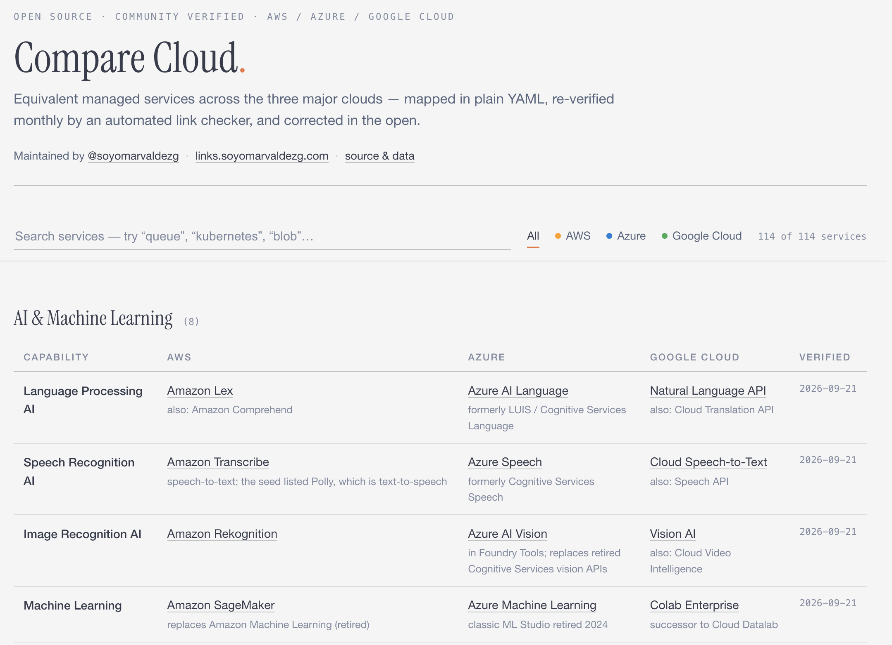

# Compare Cloud

An open, up-to-date mapping of equivalent managed services across **AWS**, **Microsoft Azure**, and **Google Cloud**.

Live site: `https://soyomarvaldezg.github.io/compare-cloud/` (after enabling GitHub Pages, see below).



## Why

The classic reference for this, [CloudComparer](https://github.com/ilyas-it83/CloudComparer), stopped being maintained around 2023: service names went stale (Azure Active Directory instead of Microsoft Entra ID), documentation URLs rotted, and retired services lingered. This project keeps the idea alive with a design built for freshness:

- **Data and presentation are separated.** The mapping lives in small YAML files — updating a service name is a one-line diff.
- **Every row carries a `verified` date**, shown on the site. Staleness is visible, not hidden.
- **A monthly detector** checks every link, follows redirects (which reveal renames), and opens an issue listing exactly which rows need attention.
- **The build fails if any row is older than 180 days** without re-verification, so the site cannot silently rot.

## Repository layout

```
data/services/*.yaml      the mapping — one file per category (the source of truth)
scripts/build.py          validates the YAML and renders the static site into site/
scripts/check_links.py    staleness detector: checks every URL, reports redirects/breakage
scripts/convert_cloudcomparer.py  one-time seed from CloudComparer (MIT), kept for provenance
.github/workflows/        Pages deploy + monthly staleness check
```

### Data format

```yaml
category: Compute
services:
  - id: virtual-server
    name: Virtual machines
    verified: 2026-09-21
    aws:
      name: Amazon EC2
      url: https://aws.amazon.com/ec2/
    azure:
      name: Azure Virtual Machines
      url: https://learn.microsoft.com/azure/virtual-machines/
    gcp:
      name: Compute Engine
      url: https://cloud.google.com/compute/
```

Rules enforced by the build: unique `id` per service, ISO `verified` date, at least one provider, `https://` URLs.

## How to contribute a correction

1. Find the service in `data/services/<category>.yaml`.
2. Edit the name/URL and bump `verified` to today.
3. Open a pull request — that's it. CI re-validates and redeploys.

## Commands

```bash
uv sync                                   # install dependencies (PyYAML)
uv run python scripts/build.py            # build the site into site/
uv run python scripts/build.py --strict   # also fail on stale rows (>180 days)
uv run python scripts/check_links.py      # check every URL (see --help for options)
```

## Staying current

A scheduled workflow runs on the 1st of every month:

1. `check_links.py` requests every service URL with a polite user agent.
2. 404s and redirect chains are classified and reported (a redirect to a renamed product page is the strongest rename signal — e.g. the old Azure AD docs redirect to `learn.microsoft.com/en-us/entra/…`).
3. The report is posted to a GitHub issue, so maintenance is a short list of one-line fixes rather than an audit.

What stays human: confirming that the suggested replacement is the right mapping. Everything up to that suggestion is mechanical.

## Provenance and license

- **AI-assisted development, honestly noted:** this project was built with AI assistance. Every data change was reviewed and verified against vendor sources before shipping; the automated link checker (above) is the ongoing guardrail. Data corrections are human-judgment calls, recorded as one-line diffs.
- Initial dataset seeded from [ilyas-it83/CloudComparer](https://github.com/ilyas-it83/CloudComparer) (MIT, © Ilyas F), pruned to AWS/Azure/GCP, with renames applied and retired documentation domains rewritten. Thanks to the original author.
- Cross-checked against official vendor references: Google's [AWS/Azure → Google Cloud comparison](https://docs.cloud.google.com/docs/get-started/aws-azure-gcp-service-comparison) and Microsoft's [AWS to Azure services comparison](https://learn.microsoft.com/en-us/azure/architecture/aws-professional/services).
- Product names and links point to vendor pages; trademarks belong to their owners.
- This repository is MIT licensed (see [LICENSE](LICENSE)).

## Enabling the site

Push this repository to GitHub as `compare-cloud`, then in **Settings → Pages** choose **Source: GitHub Actions**. The deploy workflow builds `site/` and publishes it on every push to `main`.
